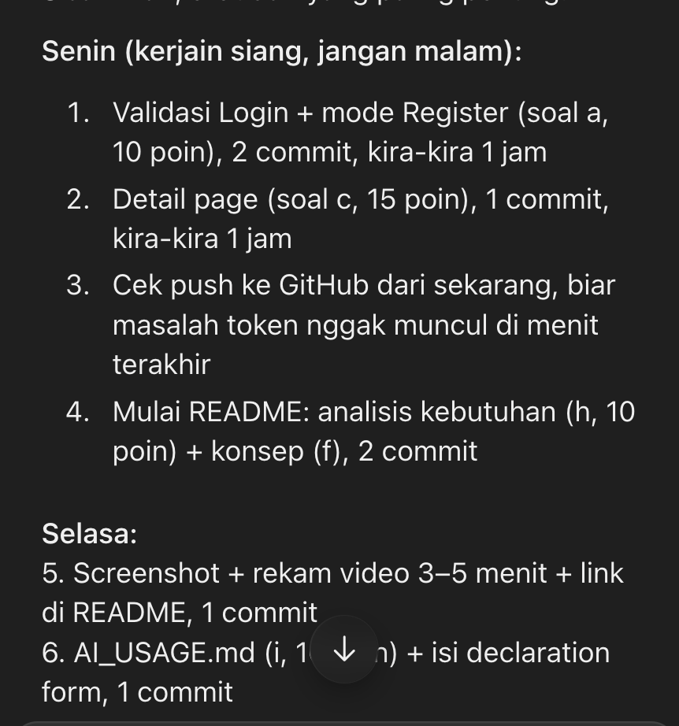
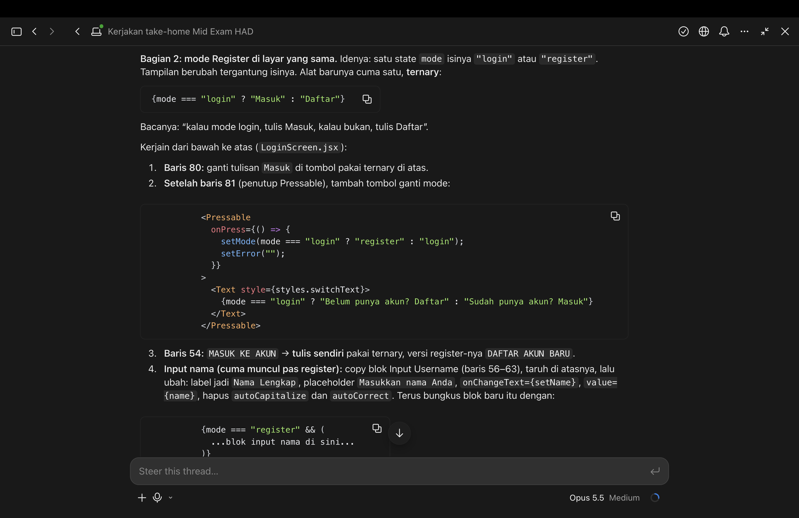
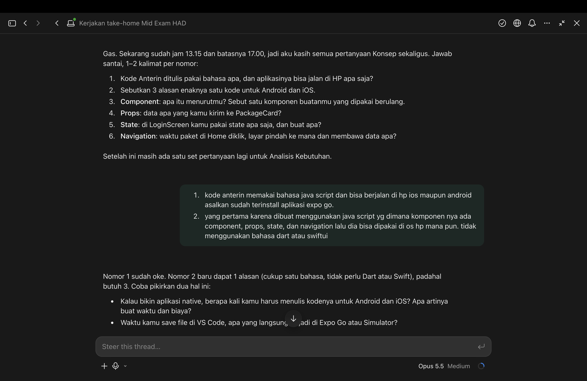
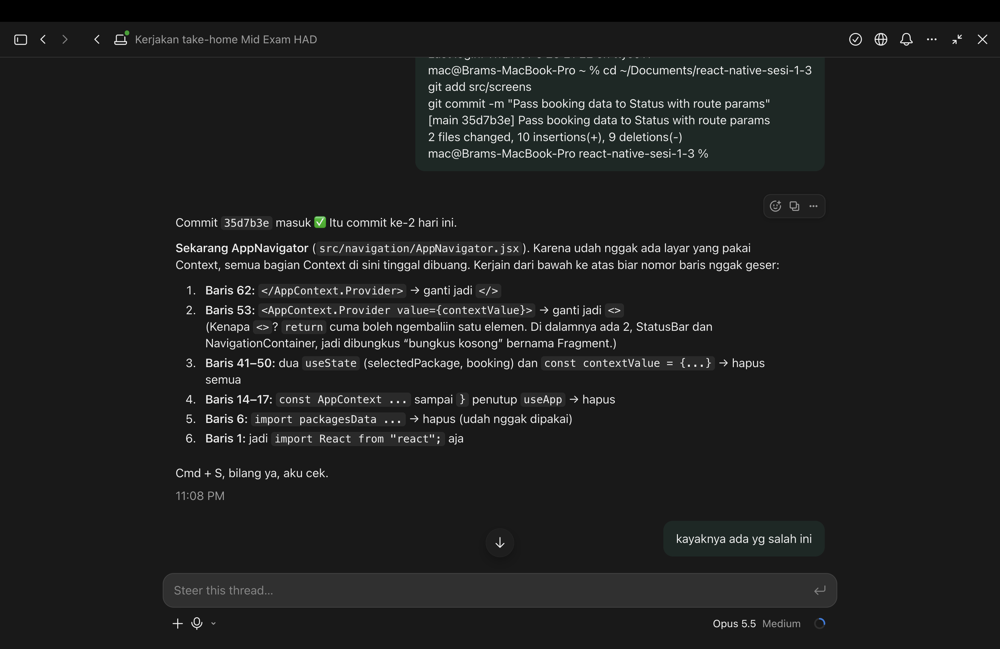
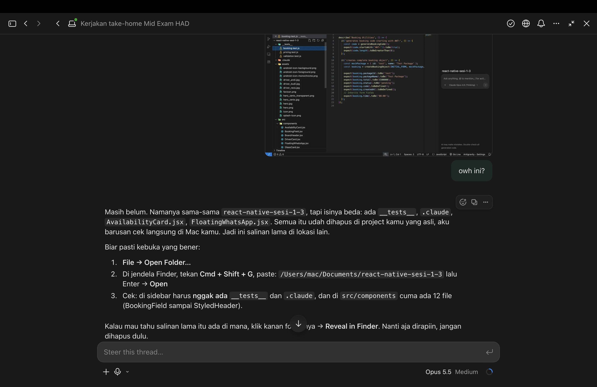

# AI_USAGE

Nama: Pande Gde Bramastha Narendra Kusuma Suyitna (2802544835)
Mata kuliah: COMP6923051 Hybrid Application Development
Tipe AI: Partial

## Alat AI yang Dipakai
- **Claude (Anthropic)**: asisten lewat chat untuk penjelasan konsep, review kode, dan membantu menyusun README.
- **Gemini (Google)**: riset jenis paket rental mobil di Semarang untuk bahan rencana pengembangan.
- **AI di Antigravity IDE**: membantu menjalankan aplikasi di Expo Go, dan membuat gambar mobil dan foto sopir di folder `assets` (hero, hero_zenix, driver_andi, driver_budi, driver_reza).

Semua kode diketik sendiri di VS Code dan di-commit sendiri.

## Log Bantuan AI

| Tanggal | Bagian | Bantuan AI | Dikerjakan sendiri |
|---|---|---|---|
| 5 Nov 2026 | Analisis soal | Membaca soal, membandingkan dengan repo, menyusun rencana kerja 5 hari | Memilih melanjutkan project Anterin |
| 5 Nov 2026 | Menghapus Context | Menyiapkan perubahan agar tema diimpor langsung dan bahasa Settings memakai useState lokal | Mengubah HomeScreen (import packages, navigate dengan packageId), commit |
| 6 Nov 2026 | Booking & Status | Menjelaskan route.params, memberi baris packageId + useState dan baris navigate ke Status | Mengetik dan menerapkan di BookingScreen, StatusScreen, AppNavigator |
| 6 Nov 2026 | Pengujian | Menguji build aplikasi di salinan terpisah | - |
| 9 Nov 2026 | Validasi Login | Memberi kode validasi (state error, cek username dan password, teks error merah) | Mengetik, menyimpan, commit |
| 9 Nov 2026 | Mode Register | Menjelaskan ternary, tombol pindah mode, style teks, blok cek nama | Ternary tombol, input Nama, state mode dan name |
| 9 Nov 2026 | Halaman Detail | Kerangka DetailScreen, baris pencarian paket, contoh Text, map fitur, tombol Pesan | Baris packageId, teks, route Detail di AppNavigator, navigate dari Home |
| 9 Nov 2026 | Gambar di Home | Petunjuk langkah demi langkah dan baris style gambar | Menambah image di packages.js dan Image di PackageCard |
| 9 Nov 2026 | Git | Menjelaskan cara membuat token GitHub | Push sendiri |
| 10 Nov 2026 | README | Template judul bagian, memberi pertanyaan, menyusun jawaban saya ke README (merapikan ejaan dan susunan), mengisi tabel kebutuhan dari komponen yang dipakai, mengambil potongan kode dari project | Semua jawaban dan ide isi README (masalah, target pengguna, kebutuhan, alasan desain, rencana pengembangan, penjelasan konsep) |
| 10 Nov 2026 | Riset paket (Gemini) | Daftar jenis paket rental mobil di Semarang | Memilih ide yang dipakai untuk rencana pengembangan |
| 10 Nov 2026 | Menjalankan di HP (agent Antigravity) | Menyesuaikan versi Expo sementara agar bisa dibuka di Expo Go untuk mengambil screenshot (perubahan ini tidak di-commit) | Mengambil screenshot layar |
| 10 Nov 2026 | Screenshot README | Claude menjalankan versi web aplikasi dari repo GitHub dan mengambil screenshot tiap layar secara otomatis | Memeriksa screenshot |
| 10 Nov 2026 | Video & AI_USAGE | Saran urutan video, menyusun log ini dari riwayat chat | Rekam dan jelaskan video sendiri, memeriksa log ini |

Gambar di folder `assets` dibuat dengan AI di Antigravity IDE sebelum ujian. Riwayat chat dan prompt-nya sudah terhapus, sehingga tidak ada screenshot bukti untuk bagian ini.

Sebelum ujian (Oktober 2026), AI juga dipakai untuk penjelasan konsep (NativeWind, TypeScript, git), panduan fitur Sesi 1–7, kerangka 4 komponen, setup TypeScript, dan membersihkan repo dari kode di luar materi.

## Bukti Screenshot

Rencana kerja dari AI (Claude):

Penjelasan ternary dan mode Register:

Pertanyaan konsep React Native untuk README dan jawaban saya:

Langkah menghapus Context di AppNavigator:

Bantuan memastikan folder project yang benar dibuka di editor:

