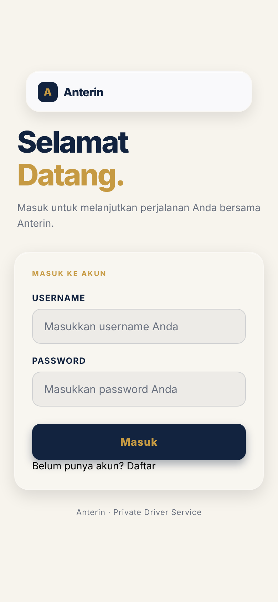
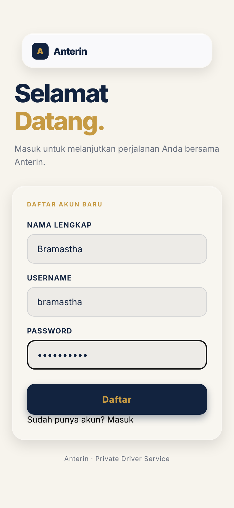
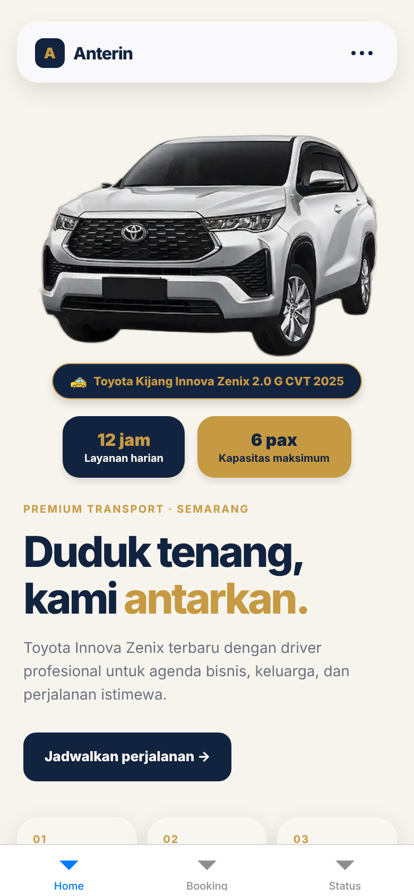
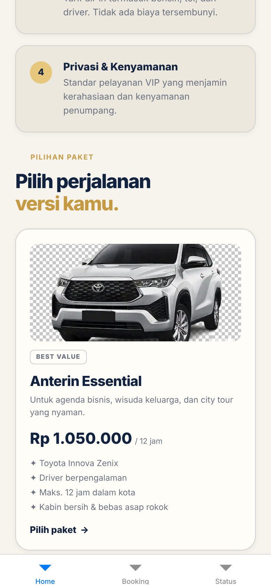
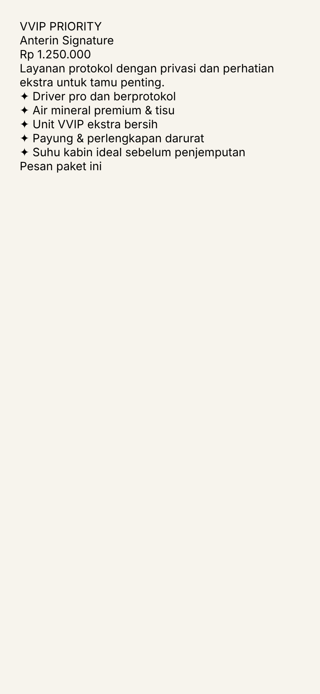
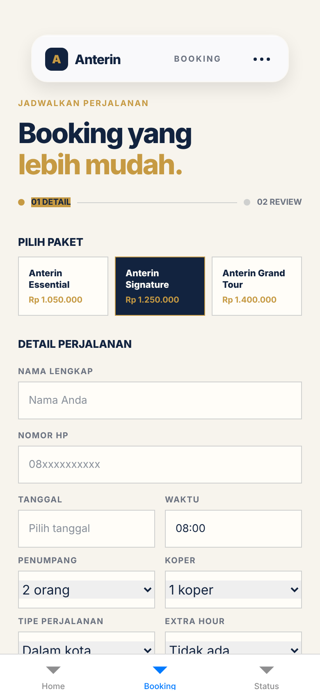
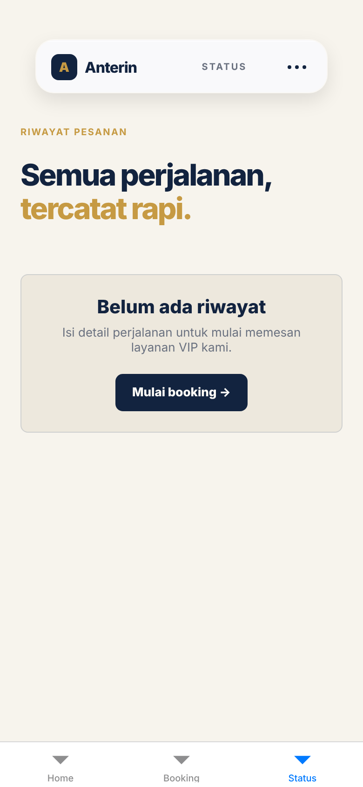
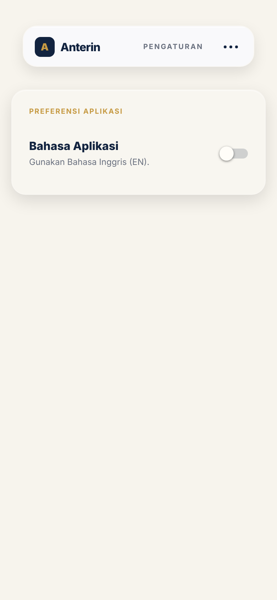

# Anterin

## Identitas
- Nama: Pande Gde Bramastha Narendra Kusuma Suyitna
- NIM: 2802544835
- Kelas: LA95
- Mata kuliah: COMP6923051 Hybrid Application Development

## Tema Aplikasi
Tema: Transportasi

Anterin ini adalah sebuah aplikasi yang berjenis transportasi rental yang melayani atau ditujukan kepada konsumen VIP maupun konsumen umum dengan menggunakan armada Innova Zenix. Aplikasi Anterin ini mengedepankan pelayanan maksimal.

## Screenshot
| Login | Register | Home |
|---|---|---|
|  |  |  |

| Daftar Paket | Detail | Booking |
|---|---|---|
|  |  |  |

| Status | Pengaturan |
|---|---|
|  |  |

## Cara Menjalankan
1. `git clone https://github.com/bramest1654/Project-React-Native.git`
2. `npm install`
3. `npx expo start`
4. Tekan `i` untuk membuka iOS Simulator, atau scan QR code dengan aplikasi Expo Go di HP

## Konsep React Native

### Cara Kerja React Native
Kode Anterin memakai bahasa JavaScript dan bisa berjalan di HP iOS maupun Android, asalkan sudah terinstal aplikasi Expo Go. Komponen yang kita tulis di kode, seperti View dan Text, tidak ditampilkan sebagai halaman web, tetapi langsung diubah menjadi tampilan asli (native) milik Android maupun iOS.

### Kelebihan Aplikasi Hybrid
1. Dibuat menggunakan JavaScript, dengan konsep component, props, state, dan navigation, lalu bisa dipakai di OS HP mana pun. Tidak perlu menggunakan bahasa native seperti Kotlin/Java untuk Android dan Swift untuk iOS.
2. Lebih hemat waktu dan biaya, karena cukup satu kode dan satu tim untuk dua platform. Aplikasi cukup dibangun dari kode di VS Code, dan hasil demonya bisa dilihat lewat simulator bawaan.
3. Kode yang kita ketik, seperti logika validasi, langsung berfungsi dan langsung tampil di aplikasi prototipe (fitur Fast Refresh).
4. Banyak programmer dan startup yang memakai React Native untuk membangun aplikasi, dan penggunanya sangat banyak.

### Components
Component adalah sebuah komponen di React Native yang fungsinya membuat potongan tampilan sekali, lalu bisa dipakai berkali-kali, seperti cetakan. Misalnya komponen Input di file LoginScreen dipakai hingga 3 kali (nama, username, dan password) dari satu file `Input.jsx`.

```jsx
<Input
  label="Username"
  placeholder="Masukkan username Anda"
  onChangeText={setUsername}
  value={username}
/>
<Input
  label="Password"
  placeholder="Masukkan password Anda"
  secureTextEntry
  onChangeText={setPassword}
  value={password}
/>
```

### Props
Props yaitu data yang dikirim dari luar ke component, seperti mengisi cetakan tadi. Contohnya, Home mengirim 3 props ke PackageCard: `item` yaitu data paketnya, `selected` yaitu paket yang sedang dipilih atau tidak, dan `onSelect` yaitu apa yang terjadi kalau kita klik kartunya.

```jsx
// HomeScreen.jsx
<PackageCard
  key={item.id}
  item={item}
  selected={false}
  onSelect={(item) => {
    navigation.navigate("Detail", { packageId: item.id });
  }}
/>

// PackageCard.jsx
export default function PackageCard({ item, selected, onSelect }) {
```

### State
State yaitu data yang bisa berubah saat aplikasi sedang berjalan, dan layar yang kita lihat otomatis ikut berubah. Contohnya di LoginScreen ada 5 state: `username`, `password`, dan `name` (isi ketikan), `error` (pesan error berwarna merah), dan `mode` (sedang di menu Login atau Register).

```jsx
const [username, setUsername] = useState("");
const [password, setPassword] = useState("");
const [error, setError] = useState("");
const [mode, setMode] = useState("login");
const [name, setName] = useState("");
```

### Navigation
Navigation adalah cara kita pindah layar UI pada aplikasi. Simpelnya, waktu paket di Home kita klik, aplikasi bakal pindah ke layar Detail sambil membawa `packageId`. Kemudian Detail memakai `packageId` itu untuk mencari paket mana yang akan ditampilkan.

```jsx
// HomeScreen.jsx
navigation.navigate("Detail", { packageId: item.id });

// DetailScreen.jsx
const packageId = route.params?.packageId;
const pkg = packages.find((p) => p.id === packageId) || packages[0];
```

## Analisis Kebutuhan

### Masalah
Anterin ini dibuat karena yang saya lihat, usaha rental lain, terutama di Semarang, hanya sekadar mengantar penumpang dari titik A ke titik B saja. Dari segi pelayanan, sopirnya mungkin kurang memberikan kesan yang positif, seperti tidak memberikan snack atau minuman, kurang ramah, dan mobilnya bau, sehingga penumpang menjadi kurang merasa nyaman. Oleh karena itu, saya menghadirkan Anterin yang mengedepankan pelayanan maksimal sehingga penumpang merasa nyaman, karena sopir kami sudah berpengalaman dalam rute dan sudah dilatih sesuai SOP.

### Target Pengguna
Target pengguna Anterin bisa bervariasi, karena kami tidak hanya membuka paket khusus VIP saja:
- **Anterin Signature (VVIP Priority)**: ditujukan ke konsumen atau klien bos, atau tamu dari luar kota yang berkepentingan rapat ke hotel.
- **Anterin Essential**: ditujukan ke keluarga untuk traveling dengan rute dalam kota.
- **Anterin Grand Tour (Long Trip)**: ditujukan ke keluarga untuk traveling ke luar kota.

Tempat tujuan bisa dipilih secara manual, atau bisa request langsung jika ingin menambah rute, asalkan masih dalam waktu yang sudah ditentukan.

### Kebutuhan Pengguna
1. **Desain UI yang elegan dan berkelas, tetapi tidak ribet**, sehingga lebih mudah dipahami saat dipakai (user friendly).
2. **Harga yang jelas dan kompetitif.** Harga bersifat sensitif. Kalau harganya lebih mahal karena embel-embel "VIP Premium" padahal usahanya masih merintis dari awal, orang-orang bakal pindah haluan. Maka dari itu kami memberi harga yang kompetitif, yang artinya disetel di bawah harga kompetitor.
3. **Pilihan paket sesuai kebutuhan konsumen**, yaitu 3 paket: Essential, Signature, dan Grand Tour.
4. **Bisa memesan sendiri** dengan mengisi data seperti nama lengkap, nomor HP yang aktif, rute dalam atau luar kota, tambahan jam, tujuan, titik penjemputan, dan catatan. Catatan ini bisa dipakai untuk meminta bantuan tambahan yang tidak ada di opsi tersebut, dan akan disampaikan ke sopir kami.
5. **Bisa mengecek kembali pesanan.** Setelah memesan, pengguna ingin tahu informasi yang sudah dipilih di menu Booking, seperti harga paket, nama paket, titik penjemputan, tempat tujuan, nomor telepon, dan lain-lain, guna memastikan apakah sudah sesuai atau tidak.

### Kebutuhan ke Screen / Komponen
| No | Kebutuhan | Screen | Komponen |
|----|-----------|--------|----------|
| 1 | Desain UI elegan dan mudah dipakai | Semua layar (Login, Home, Detail, Booking, Status, Settings) | BrandHeader, GlassCard |
| 2 | Harga yang jelas dan kompetitif | Home, Detail, Booking | PackageCard, PriceSummary |
| 3 | Pilihan paket sesuai kebutuhan | Home, Detail | PackageCard |
| 4 | Bisa memesan sendiri | Booking | BookingField, Picker |
| 5 | Bisa mengecek kembali pesanan | Status | BrandHeader |

### Alasan Desain
Warna navy dan emas dipilih karena ingin tampil berbeda dibandingkan aplikasi atau web rental lain, dan sesuai dengan tema kami yang premium. Selain itu, warna ini dipilih karena menyejukkan dan membuat mata terasa nyaman saat memakainya.

Tab di bagian bawah (Home, Booking, Status) dipakai sebagai shortcut untuk memudahkan pengguna langsung pindah ke menu utama, agar tidak ribet dan lebih intuitif.

### Rencana Pengembangan
Ke depannya, Anterin akan menambah:
1. **Kemitraan B2B untuk paket Signature**, agar paket Signature bisa merambah luas ke B2B dengan sistem kemitraan (hotel dan perusahaan), sehingga Anterin semakin maju dan lebih banyak yang memakainya.
2. **Paket antar-jemput bandara dan stasiun**, karena klien atau tamu mayoritas berasal dari luar kota menggunakan pesawat atau kereta, misalnya untuk kepentingan rapat penting.
3. **Paket sewa mingguan/bulanan untuk perusahaan**, sebagai paket baru setelah menjalankan sistem kemitraan.
4. **Login dan registrasi asli yang terhubung ke server, beserta riwayat pesanan**, agar data pengguna aman. Saat ini data pesanan masih dicatat secara manual oleh admin dan direkap di Google Sheets, sehingga ke depannya akan dipindahkan ke database di server.
5. **Pembayaran langsung di aplikasi**, sehingga pengguna cukup membuka aplikasi untuk membayar melalui transfer bank seperti BCA, Mandiri, BRI, dan lainnya.

## Video Demo
Link: https://drive.google.com/drive/folders/1uUn7avnlXCweThP9CRHVj-hFvmYJdktJ?usp=sharing

## Penggunaan AI
Lihat [AI_USAGE.md](AI_USAGE.md).
